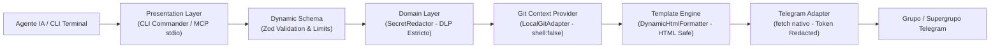

# tg-dev-bridge 🚀 (Bot Factory & Template Engine)

Puente empresarial de **ChatOps** desacoplado (**CLI + MCP Server**) diseñado para conectar agentes de desarrollo en terminal (**Claude Code**, **OpenCode**, **AgU**, **Cursor**) y pipelines de CI/CD con grupos de Telegram.

Permite generar y operar múltiples perfiles de bots (reportes de desarrollo, lanzamientos, bugs, alertas operativas) mediante archivos declarativos JSON en `profiles/`, sin tocar una sola línea de código fuente.

---

## 🤖 AI Agent Primer (Lectura Rápida para Agentes de IA)

> **Contexto para Agentes Autónomos:** Si fuiste invocado para operar en este repositorio o para usar `tg-bridge`, lee este resumen ejecutivo:

1. **¿Qué hace esta herramienta?**  
   Envía reportes estructurados a Telegram al terminar tareas, alertar incidentes o lanzar versiones.
2. **¿Cómo se invoca?**
   - **Vía MCP:** Llama a `send_dev_update` (o la herramienta del perfil activo).
   - **Vía CLI:** Ejecuta `tg-bridge -d "Cambio 1" -n "Paso 1"`.
   - **Vía Stdin:** Envía JSON por pipe: `cat payload.json | tg-bridge --stdin`.
3. **Reglas de Seguridad Inquebrantables:**
   - **DLP Activo:** El sistema **aborta inmediatamente** si incluyes tokens de GitHub (`ghp_`), API keys (`sk-`, `AKIA`), JWTs o URLs con contraseñas. Redacta o elimina los secretos antes de enviar.
   - **Package Manager:** Usa **exclusivamente `pnpm`** (`pnpm install`, `pnpm run build`, `pnpm run test:security`).
4. **Perfiles disponibles por defecto:**
   - `dev-update` *(default)*: Reporte de cambios de código y siguientes pasos.
   - `release-notes`: Publicación de versiones, highlights y enlace de despliegue.
   - `bug-report`: Alertas de fallos, severidad y pasos de reproducción.

Para directivas detalladas de prompts, consulta [`CLAUDE.md`](./CLAUDE.md) y [`.agent-rules.md`](./.agent-rules.md).

---

## 🏛️ Flujo de Ejecución y Arquitectura



### Separación de Capas (Clean Architecture)

```text
profiles/                               # Perfiles declarativos de bots
├── dev-update.json                     # Bot de reporte de tareas (default)
├── release-notes.json                  # Bot de anuncios de despliegues y versiones
└── bug-report.json                     # Bot de alertas de incidentes / errores

src/
├── domain/                             # Entidades puras y reglas de negocio
│   ├── entities/BotProfile.ts          # Esquemas Zod estrictos y tipos del perfil
│   ├── entities/DevUpdate.ts           # Entidad inmutable de desarrollo
│   ├── services/SecretRedactor.ts      # DLP estricto contra fuga de credenciales
│   └── ports/                          # Puertos / Interfaces (Strategy Pattern)
│       ├── ITemplateEngine.ts          # Contrato de renderizado
│       ├── IDynamicNotificationService.ts # Envío desacoplado con credenciales
│       └── IGitContextProvider.ts
│
├── application/                        # Casos de uso
│   ├── use-cases/PublishReportUseCase.ts # Orquestador genérico por perfil
│   └── use-cases/PublishDevUpdateUseCase.ts # Retrocompatibilidad
│
├── infrastructure/                     # Adaptadores concretos
│   ├── config/ProfileLoader.ts         # Confinamiento contra Path Traversal (CWE-22)
│   ├── config/TelegramProfileResolver.ts # Resolución de tokens por perfil
│   ├── git/LocalGitAdapter.ts          # Ejecución segura de Git con timeouts (CWE-78)
│   └── telegram/
│       ├── DynamicHtmlFormatter.ts     # Template engine nativo con sanitización HTML
│       └── TelegramAdapter.ts          # Cliente HTTP nativo con ofuscación de tokens (CWE-209)
│
└── presentation/                       # Puntos de entrada ejecutables (Dual Mode)
    ├── cli/
    │   ├── index.ts                    # Binario CLI con inyección dinámica de flags
    │   └── commands/initBot.ts         # Generador de scaffolding de perfiles
    └── mcp/server.ts                   # Servidor MCP stdio con Dynamic Schema Injection
```

---

## ⚡ Instalación y Setup en 1 Minuto

### 1. Inicializar el proyecto
```bash
git clone <tu-repositorio> tg-dev-bridge
cd tg-dev-bridge
./scripts/setup-template.sh
```

El script verificará Node 20+, instalará dependencias con `pnpm`, compilará TypeScript y enlazará globalmente el comando `tg-bridge`.

### 2. Configurar credenciales (`.env`)
Edita tu `.env` (o crea un archivo global en `~/.config/tg-dev-bridge/.env`):

```bash
TELEGRAM_BOT_TOKEN=123456789:ABCdefGHIjklMNOpqrsTUVwxyz
TELEGRAM_CHAT_ID=-1001234567890

# Opcional: ID de tema/topic en supergrupos con foros
TELEGRAM_THREAD_ID=42
```

---

## 🛠️ Cómo Crear un Nuevo Bot (`tg-bridge init`)

Para generar un nuevo perfil de bot en segundos sin programar:

```bash
tg-bridge init deploy-alert --preset release-notes
```

**Presets disponibles:**
- `dev-update` — Reportes de tareas completadas y próximos pasos.
- `release-notes` — Versión, highlights, breaking changes y enlace de despliegue.
- `bug-report` — Severidad, resumen, pasos para reproducir y mitigación.
- `custom` — Plantilla genérica editable con título, detalles y notas.

El archivo resultante en `profiles/deploy-alert.json` se puede editar para personalizar campos, textos y encabezados.

---

## 🤖 Registro en Claude Code (MCP Server Dinámico)

Cada perfil puede registrarse como un servidor MCP independiente. Claude Code leerá el esquema dinámicamente:

### Bot de Desarrollo (default):
```bash
claude mcp add dev-tracker node $(pwd)/dist/presentation/mcp/server.js
```

### Bot de Notas de Versión:
```bash
claude mcp add release-bot node $(pwd)/dist/presentation/mcp/server.js --profile release-notes
```

### O vía `claude_desktop_config.json`:
```json
{
  "mcpServers": {
    "tg-bridge": {
      "command": "node",
      "args": ["/ruta/absoluta/tg-dev-bridge/dist/presentation/mcp/server.js", "--profile", "dev-update"]
    }
  }
}
```

---

## 🖥️ Uso desde Terminal (CLI)

### 1. Reporte de Desarrollo (Perfil `dev-update` por defecto)
```bash
tg-bridge \
  -d "Implementado interceptor DLP" "Añadida suite de seguridad" \
  -n "Preparar despliegue a staging"
```

### 2. Notas de Versión (Perfil `release-notes`)
```bash
tg-bridge --profile release-notes \
  --version "v2.0.0" \
  --highlights "DLP corporativo en modo estricto" "Template Engine dinámico" \
  --deploy-url "https://github.com/usuario/repo/releases/tag/v2.0.0"
```

### 3. Vía JSON por `stdin`
```bash
cat << 'EOF' | tg-bridge --profile bug-report --stdin
{
  "severity": "Crítico",
  "summary": "Falla en procesamiento de webhooks",
  "stepsToReproduce": ["Enviar payload con timeout corto", "Observar 504 Gateway Timeout"]
}
EOF
```

---

## 🛡️ Seguridad Empresarial y Auditoría

Este repositorio incluye auditoría formal de seguridad bajo `ai-first-security-auditor`:
- **DLP Activo:** Expresiones regulares de alta entropía para AWS, GitHub PATs, Anthropic/OpenAI keys, JWTs y URLs de base de datos.
- **Protección contra Path Traversal (CWE-22):** Confinamiento canónico con `fs.realpathSync`.
- **Subprocesos Seguros (CWE-78):** Invocaciones de Git con `shell: false`, timeouts de 3s y buffers acotados.
- **Sanitización de Errores (CWE-209):** Ofuscación automática de tokens en URLs y respuestas de error.
- **Límites de Mensaje:** Truncado seguro a <4096 caracteres cerrando tags HTML pendientes.

Para consultar la matriz completa de riesgos, revisa [`SECURITY_AUDIT.md`](./SECURITY_AUDIT.md).

### Ejecutar Suite de Seguridad
```bash
pnpm run test:security
```

---

## 🐳 Despliegue con Docker (Rootless)

Si prefieres ejecutar el bot en contenedores:

```bash
# Construir imagen con usuario no privilegiado (node)
docker build -t tg-dev-bridge .

# Ejecutar reporte montando las variables de entorno
docker run --rm --env-file .env tg-dev-bridge -d "Despliegue exitoso en Docker" -n "Monitorear métricas"
```

---

## 🧪 Comandos de Desarrollo

```bash
# Comprobación de tipos
pnpm run typecheck

# Compilar proyecto TypeScript
pnpm run build

# Ejecutar suite de pruebas de seguridad
pnpm run test:security
```
